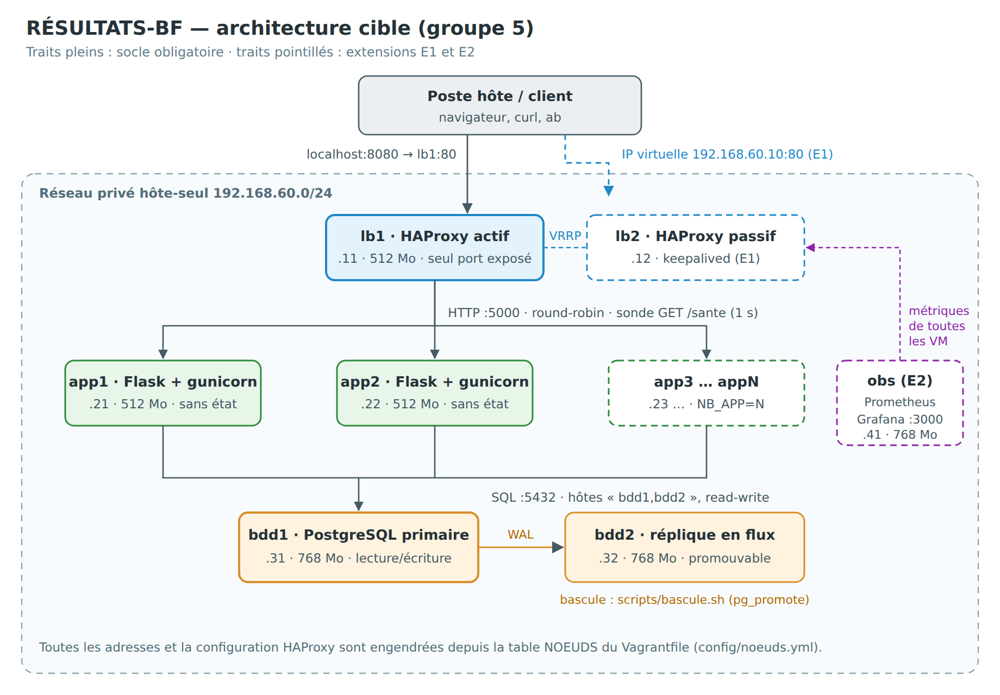
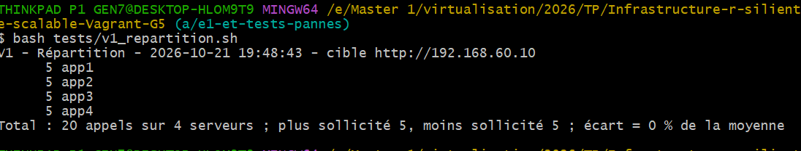
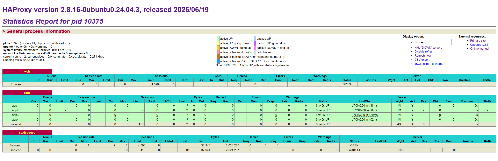
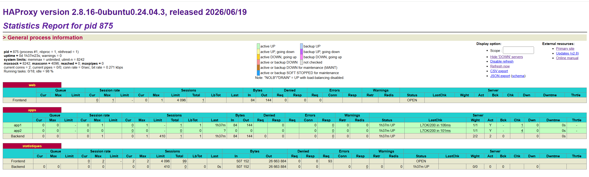
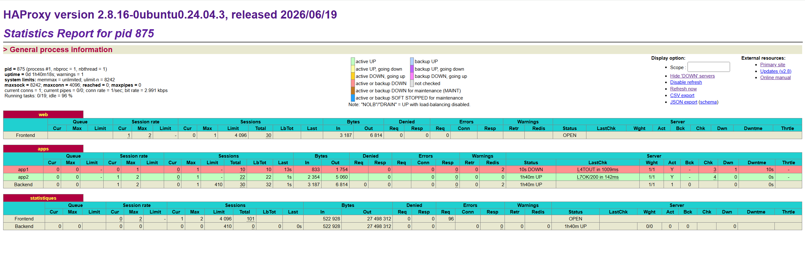
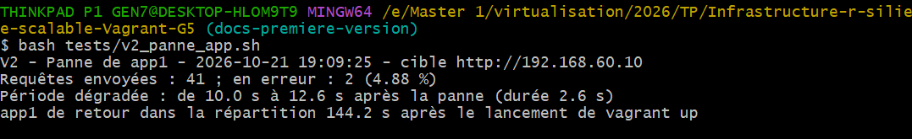

# Dossier d'architecture - RÉSULTATS-BF

**Groupe 5** · Master 1 Informatique - Virtualisation et Cloud Computing · Enseignant : Dr SOMDA Flavien Hervé · IBAM, Université Joseph Ki-Zerbo · Rendu le 25 octobre 2026

| Membre | Rôle |
|---|---|
| … | A - Architecte réseau, répartition et intégration |
| … | B - Ingénieur applicatif, sécurité et documentation |
| … | C - Ingénieur données |
| … | D - Essais et observabilité |

> **Statut du document** : brouillon tenu par le rôle B. Les passages marqués
> `[À COMPLÉTER - rôle X]` attendent l'information du membre concerné ; les
> passages marqués `[MESURE]` ne doivent être remplis qu'avec des chiffres
> produits par les scripts de `tests/` (sortie brute conservée dans `resultats/`).

---

## Sommaire

1. Contexte et exigences
2. Architecture
3. Justification des choix
4. Points de défaillance unique
5. Application sans état
6. Données et réplication
7. Sécurité
8. Procédures d'exploitation
9. Résultats des scénarios V1 à V6
10. Extensions réalisées
11. Limites connues et ce que nous ferions autrement
12. Annexes

---

## 1. Contexte et exigences

Chaque année, la publication des résultats d'examen fait tomber le site de
consultation dans les minutes qui suivent l'annonce. La cause n'est presque
jamais le programme lui-même : c'est une infrastructure pensée pour une seule
machine, qui ne supporte ni un pic de consultations ni la panne d'un serveur.

La plateforme **RÉSULTATS-BF** permet à un candidat de consulter son résultat à
partir de son matricule. Deux exigences non fonctionnelles priment :

- **Résilience** : la panne d'une machine ne doit pas interrompre le service ;
- **Scalabilité** : absorber plus de trafic doit se faire en ajoutant des
  machines, sans réécrire la configuration.

Toute l'infrastructure est décrite en code et se reconstruit sur n'importe quel
poste avec `vagrant destroy -f` puis `vagrant up`, sans aucun geste manuel.

### 1.1 Contraintes

| Contrainte | Valeur retenue |
|---|---|
| Outils | Vagrant 2.4 + VirtualBox 7, sur poste personnel |
| Boîte | `bento/ubuntu-24.04`, version épinglée `202510.26.0` (fournisseur virtualbox, amd64) |
| Réseau | Sous-réseau du groupe 5 : `192.168.60.0/24` (plage hôte-seul autorisée par défaut par VirtualBox) |
| Mémoire | Socle obligatoire ≤ 3 Go (5 VM : 2 × 768 Mo + 3 × 512 Mo = 3 072 Mo) |
| Coût | Aucun : ni compte cloud, ni image construite à la main |
| Connexion | Provisionnement compatible avec une connexion lente (paquets groupés, `apt-get update` limité) |

### 1.2 Exigences obligatoires et où elles sont traitées

| N° | Exigence | Mise en œuvre | Fichiers |
|---|---|---|---|
| R1 | Reconstruction intégrale | Provisionnement entièrement scripté ; `.env` créé automatiquement s'il manque | `Vagrantfile`, `scripts/` |
| R2 | Idempotence | Fichiers réécrits seulement si leur contenu change ; création conditionnelle des rôles, de la base et des données | `scripts/lib.sh`, `config/schema.sql` |
| R3 | Nombre de serveurs paramétrable | `NB_APP` ; configuration HAProxy engendrée depuis `config/noeuds.yml` | `Vagrantfile`, `scripts/generer_haproxy.py` |
| R4 | Sonde de santé | `option httpchk GET /sante`, toutes les 1 s, serveur écarté après 2 échecs | `scripts/generer_haproxy.py`, `app/app.py` |
| R5 | Réplication en flux | `pg_basebackup -R` depuis bdd1 ; bdd2 en lecture seule | `scripts/replique.sh` |
| R6 | Bascule écrite et chronométrée | Promotion de bdd2 par `pg_promote()`, chronomètre intégré | `scripts/bascule.sh` |
| R7 | Aucun secret dans le dépôt | `.env` ignoré par Git, `.env.exemple` versionné | `.gitignore`, `.env.exemple` |
| R8 | Trafic interne sur le réseau privé | Seul lb1 a une redirection de port ; services liés aux IP privées | `Vagrantfile`, `scripts/pg_commun.sh` |

---

## 2. Architecture



*Figure 1 - Architecture cible. Traits pleins : socle obligatoire ; pointillés : extensions E1 et E2.*

### 2.1 Inventaire des machines virtuelles

| Machine | Rôle | Adresse | RAM | Statut |
|---|---|---|---|---|
| lb1 | Répartiteur HAProxy actif, seul port exposé (hôte 8080 → 80) | 192.168.60.11 | 512 Mo | Obligatoire |
| lb2 | Répartiteur passif, keepalived | 192.168.60.12 | 512 Mo | Extension E1 |
| - | IP virtuelle VRRP partagée par lb1 et lb2 | 192.168.60.10 | - | Extension E1 |
| app1 … appN | Service applicatif sans état (Flask + gunicorn, port 5000) | 192.168.60.21 … .2N | 512 Mo | Obligatoire, N ≥ 2 |
| bdd1 | PostgreSQL primaire (lecture et écriture) | 192.168.60.31 | 768 Mo | Obligatoire |
| bdd2 | PostgreSQL réplique en flux, promouvable | 192.168.60.32 | 768 Mo | Obligatoire |
| obs | Prometheus + Grafana | 192.168.60.41 | 768 Mo | Extension E2 |

### 2.2 Parcours d'une requête

1. Le client appelle `http://localhost:8080/resultat?matricule=BF000123`
   (ou l'IP virtuelle `192.168.60.10` avec l'extension E1).
2. HAProxy, sur lb1, choisit un serveur applicatif **sain** à tour de rôle
   (round-robin). Un serveur dont la sonde `/sante` échoue deux fois de suite
   ne reçoit plus de trafic.
3. Le serveur applicatif ouvre une connexion PostgreSQL vers « bdd1, puis
   bdd2 », en exigeant un serveur qui accepte les écritures
   (`target_session_attrs=read-write`). En temps normal, c'est bdd1.
4. Il exécute une requête paramétrée, ferme la connexion et renvoie le JSON.
5. Chaque écriture sur bdd1 est transmise en continu à bdd2 (journal WAL).

### 2.3 Source unique de vérité

La table `NOEUDS` du `Vagrantfile` décrit toutes les machines (nom, adresse,
mémoire, rôle). À chaque commande Vagrant, elle est écrite dans
`config/noeuds.yml`, d'où sont **engendrés** :

- la liste des serveurs de HAProxy (`scripts/generer_haproxy.py`) ;
- le bloc `/etc/hosts` de chaque VM (`scripts/commun.sh`) ;
- les cibles de Prometheus (`scripts/obs.sh`).

Aucune adresse de serveur applicatif n'est écrite en dur ailleurs. Passer de
2 à 4 serveurs se fait en changeant **une seule valeur** : `NB_APP=4`.

### 2.4 Ordre de démarrage

Vagrant démarre les VM dans l'ordre de la table : bdd1, bdd2, app1…appN, lb1,
lb2, obs. La base est donc prête avant les applications, et les applications
avant le répartiteur. En complément, l'application tolère une base absente au
démarrage : elle ouvre une connexion par requête et réessaie d'elle-même.

---

## 3. Justification des choix

| Choix | Alternatives envisagées | Pourquoi ce choix |
|---|---|---|
| **HAProxy** comme répartiteur | Nginx | Sondes de santé HTTP actives intégrées et gratuites (`option httpchk`), page de statistiques, exporteur Prometheus intégré. Nginx libre ne fait que des sondes passives. |
| **Sonde `/sante` qui interroge la base** | Sonde TCP sur le port 5000 | Un serveur dont le processus tourne mais qui ne joint plus la base est inutile. La sonde ne renvoie 200 que si `SELECT 1` réussit (exigence R4 : jamais 200 « par principe »). |
| **Configuration HAProxy engendrée** depuis `noeuds.yml` | Liste écrite à la main | Exigence R3, et pénalité de −2 points pour une adresse en dur. Le provisionnement de lb1 est rejoué à chaque `vagrant up` (`run: "always"`) pour suivre `NB_APP`. |
| **Python : Flask + gunicorn**, installés par `apt` | Node.js, paquets `pip` | Paquets disponibles dans Ubuntu 24.04 : pas de dépendance à PyPI, installation plus rapide sur connexion lente. Gunicorn fournit plusieurs processus (2 workers × 4 threads). |
| **Une connexion PostgreSQL par requête** | Pool de connexions en mémoire | Aucun état dans le serveur applicatif (contrainte structurante). L'application démarre même si la base est absente et suit une bascule sans redémarrer. Coût : latence d'ouverture de connexion (voir limites). |
| **Chaîne de connexion multi-hôtes** (`host=bdd1,bdd2 target_session_attrs=read-write`) | Modifier la configuration des apps lors d'une bascule | Après promotion de bdd2, les serveurs applicatifs l'utilisent seuls, sans intervention ni redémarrage : la bascule se réduit à une commande. |
| **Réplication en flux PostgreSQL** (`pg_basebackup -R`) | Réplication logique, sauvegarde/restauration | Mécanisme natif, réplique complète et en lecture seule, promotion en une commande (`pg_promote`). |
| **Bascule de la base manuelle mais scriptée** | Patroni, repmgr | Exigence R6 : procédure « écrite, exécutable et chronométrée ». Un outil de bascule automatique ajoute un service de consensus (etcd) hors de portée du budget mémoire. |
| **keepalived en VRRP unicast** (E1) | VRRP multicast | Le multicast est souvent filtré sur les réseaux hôte-seul de VirtualBox ; l'unicast entre lb1 et lb2 est plus fiable. |
| **`.env` engendré automatiquement** s'il manque | Demander de copier `.env.exemple` | R1 interdit tout geste manuel ; R7 interdit les secrets dans le dépôt. Les mots de passe sont tirés au hasard au premier `vagrant up`. |
| **Données PostgreSQL hors de `/vagrant`** | Dossier synchronisé | Les verrous et la durabilité de PostgreSQL ne fonctionnent pas dans un dossier partagé VirtualBox (piège n°3 du sujet). |

**Choix ajoutés pendant la mise au point (rôle A)**

| Choix | Alternative | Pourquoi |
|---|---|---|
| **Version de boîte `202510.26.0`** | Version `202404.23.0` de l'annexe | Version disponible au catalogue et avec laquelle le socle a été construit ; épinglée pour que tous les postes utilisent la même image (R1). |
| **Provisionneurs `commun`, `keepalived` et `obs` rejoués à chaque `vagrant up`** (`run: "always"`) | Exécution au premier démarrage seulement | Sans cela, activer E1 sur une plateforme existante n'installait keepalived que sur lb2, et `/etc/hosts` ou les cibles Prometheus ne suivaient pas `NB_APP`. Les scripts sont idempotents (R2), donc les rejouer ne change rien quand la topologie est stable. |
| **`NB_APP` fixé dans `.env`** plutôt que sur la ligne de commande | `NB_APP=4 vagrant up` seul | Chaque commande Vagrant réécrit `config/noeuds.yml` : une valeur donnée une seule fois en ligne de commande serait perdue au `vagrant up lb1` suivant. Le Vagrantfile affiche un avertissement si des VM `appN` existent au-delà de `NB_APP`. |
| **Paramètre `PAREFEU` lu comme les autres** (ligne de commande ou `.env`) | Lecture dans `.env` seulement | Cohérence avec `NB_APP`, `AVEC_LB2` et `AVEC_OBS`. |
| **Résolution DNS par l'hôte** (`--natdnshostresolver1 on`) et nouvel essai d'apt | DNS NAT par défaut de VirtualBox | Un changement de réseau du poste rendait le DNS des VM invalide et faisait échouer `vagrant up` (R1). |

---

## 4. Points de défaillance unique

| Composant | Que se passe-t-il s'il tombe ? | Traitement |
|---|---|---|
| Un serveur applicatif | HAProxy l'écarte en ~2 s ; les requêtes en cours sont rejouées sur un autre serveur (`option redispatch`, `retries 2`) | **Supprimé** (N ≥ 2) - scénario V2 |
| lb1 (socle seul) | Plus aucun accès au service | **Point unique dans le socle** ; supprimé par l'extension E1 |
| lb1 (avec E1) | keepalived déplace l'IP virtuelle `.10` vers lb2 | **Supprimé** - scénario V6 |
| bdd1 | `/sante` renvoie 503 sur tous les serveurs ; HAProxy renvoie une page 503 JSON propre | **Atténué** : bascule manuelle sur bdd2 (R6) - scénario V4 |
| bdd2 | Plus de réplique : aucun impact sur le service, mais plus de bascule possible | **Accepté** : à reconstruire avec `vagrant destroy -f bdd2 && vagrant up bdd2` |
| Le poste hôte | Toutes les VM tombent | **Hors périmètre** : limite d'un environnement à une seule machine physique |

---

## 5. Application sans état

Le service (`app/app.py`, moins de 100 lignes) expose trois points d'entrée :

| Point d'entrée | Réponse normale | En cas de problème |
|---|---|---|
| `GET /resultat?matricule=BF000123` | 200 + JSON (matricule, nom, série, moyenne, admis, serveur) | 400 si matricule mal formé ; 404 si inconnu ; 503 JSON si base injoignable |
| `GET /sante` | 200 si `SELECT 1` réussit | 503 JSON sinon - jamais 200 par principe |
| `GET /info` | 200 + nom d'hôte du serveur | - |

**Absence d'état.** Le serveur ne garde ni session, ni fichier, ni compteur :
chaque requête ouvre une connexion, lit, ferme. Tout état vit dans la base.
Ajouter un serveur est donc trivial et en retirer un est indolore.

**Robustesse.** Toute erreur PostgreSQL est interceptée et transformée en
réponse 503 JSON lisible. Le service est géré par systemd (`Restart=always`)
et écoute sur `0.0.0.0:5000` pour être joignable depuis lb1.

`[À COMPLÉTER - rôle B : exemples de réponses réelles copiées depuis la plateforme]`

---

## 6. Données et réplication

### 6.1 Schéma et jeu de données

```sql
CREATE TABLE resultats (
    matricule  varchar(12)  PRIMARY KEY,   -- BF000001 … BF050000
    nom        varchar(80)  NOT NULL,
    serie      varchar(4)   NOT NULL,      -- A4, C, D, E, F, G1, G2
    moyenne    numeric(4,2) NOT NULL CHECK (moyenne BETWEEN 0 AND 20),
    admis      boolean      NOT NULL       -- moyenne >= 10
);
```

Les 50 000 lignes sont engendrées par `generate_series`, avec une graine fixe
(`setseed(0.42)`) : le jeu de données est identique sur tous les postes, ce qui
rend les mesures comparables. Le compte `app` n'a que le droit `SELECT`.

### 6.2 Réplication

bdd2 est initialisée une seule fois par `pg_basebackup -R -X stream` depuis
bdd1, puis reçoit le journal WAL en continu. Elle est en lecture seule
(`pg_is_in_recovery() = true`). Un marqueur empêche un nouveau provisionnement
d'effacer une base déjà promue.

**Vérification de R5** `[À COMPLÉTER - rôle C : commandes exactes et sortie]` :

```bash
vagrant ssh bdd1 -c "sudo -u postgres psql -d resultats -c \"INSERT INTO resultats VALUES ('BF999999','Test réplication','C',12.5,true)\""
vagrant ssh bdd2 -c "sudo -u postgres psql -d resultats -c \"SELECT * FROM resultats WHERE matricule='BF999999'\""
```

---

## 7. Sécurité

| Mesure | Détail |
|---|---|
| Secrets hors du dépôt (R7) | `.env` ignoré par Git ; `.env.exemple` sans valeur réelle ; mots de passe aléatoires de 32 caractères hexadécimaux |
| Secrets dans les VM | Fichier `/etc/resultats-bf/app.env` en mode 600, lu par systemd ; jamais affiché dans les journaux |
| Cloisonnement réseau (R8) | Seul lb1 a une redirection de port, liée à `127.0.0.1` de l'hôte ; PostgreSQL n'écoute que sur `localhost` et l'IP privée ; `pg_hba.conf` n'accepte que `192.168.60.0/24` |
| Moindre privilège | Compte PostgreSQL `app` en lecture seule ; service lancé par un compte système sans shell ; options systemd `NoNewPrivileges`, `ProtectSystem=strict`, `ProtectHome`, `PrivateTmp` |
| Entrées | Matricule validé par expression régulière (`^[A-Z]{2}[0-9]{6}$`) ; requêtes SQL paramétrées (pas d'injection) |
| Pare-feu | `scripts/parefeu.sh` : ufw par rôle, n'ouvre que les ports nécessaires depuis le sous-réseau `[À COMPLÉTER - rôle B : activé ou non après tests]` |
| Historique Git | Vérifié par `git log -p \| grep -iE "password\|passwd"` avant le rendu `[À COMPLÉTER]` |

---

## 8. Procédures d'exploitation

### 8.1 Construire ou reconstruire la plateforme (R1)

```bash
git clone <url-du-depot> resultats-bf && cd resultats-bf
vagrant up                       # première construction
vagrant destroy -f && vagrant up # reconstruction intégrale
```

Contrôle : `curl http://localhost:8080/sante` renvoie `{"statut":"ok", ...}`.

### 8.2 Ajouter des serveurs applicatifs (R3)

```bash
NB_APP=4 vagrant up    # ou NB_APP=4 dans .env, puis vagrant up
```

Ce qui se passe :

1. Le Vagrantfile ajoute app3 (`.23`) et app4 (`.24`) à la table `NOEUDS` et
   réécrit `config/noeuds.yml`.
2. Vagrant crée et provisionne app3 et app4.
3. Le provisionnement de lb1, rejoué à chaque `vagrant up`, réengendre
   `haproxy.cfg` avec 4 serveurs, le valide (`haproxy -c`) puis recharge HAProxy
   sans coupure (`reload`).

Contrôle : `bash tests/v1_repartition.sh` doit montrer les 4 serveurs. En cas
de doute : `vagrant provision lb1`.

**Retirer des serveurs** : détruire les VM en trop AVANT de baisser `NB_APP` :
`NB_APP=4 vagrant destroy -f app3 app4` (la valeur passée sur la ligne de
commande est prioritaire sur `.env`), puis mettre `NB_APP=2` dans `.env` et
lancer `vagrant provision lb1` (contrôle : « HAProxy prêt : 2 serveurs
applicatifs »). Si `NB_APP` est baissé d'abord, Vagrant ne voit plus app3 et
app4 (« machine not found ») alors qu'elles tournent encore dans VirtualBox ; le
Vagrantfile affiche alors un avertissement.

### 8.3 Bascule de la base sur bdd2 (R6)

À exécuter depuis l'hôte, à la racine du dépôt, quand bdd1 est hors service :

```bash
bash scripts/bascule.sh
```

| Étape | Action | Commande exécutée par le script |
|---|---|---|
| 1 | Vérifier que bdd2 est bien une réplique | `SELECT pg_is_in_recovery()` |
| 2 | Promouvoir bdd2 en primaire | `SELECT pg_promote(true, 30)` |
| 3 | Attendre le retour du service via le répartiteur | `curl /sante` jusqu'à obtenir 200 |
| 4 | Afficher la durée totale | chronomètre intégré |

Aucune modification n'est nécessaire sur les serveurs applicatifs : leur chaîne
de connexion choisit automatiquement le serveur qui accepte les écritures.
Le script attend au plus 60 secondes le retour de `/sante` ; au-delà, il s'arrête
avec une erreur au lieu d'attendre indéfiniment.

### 8.4 Remettre bdd1 en service après une bascule

> ⚠️ Ne **jamais** relancer bdd1 tel quel après une bascule : il redémarrerait
> en primaire et deux bases accepteraient les écritures (« split brain »).

La remise en service est manuelle. Elle efface l'ancien répertoire de données
PostgreSQL de bdd1 et le remplace par une copie de la base primaire bdd2. Cette
procédure ne doit être lancée qu'après avoir vérifié que bdd2 est primaire.
Pendant toute l'opération, les services applicatifs restent arrêtés afin
d'empêcher les écritures sur l'ancienne bdd1 lorsqu'elle redémarre.

Depuis Git Bash, à la racine du dépôt :

1. Arrêter les écritures applicatives :

   ```bash
   for vm in $(vagrant status --machine-readable | awk -F, '$3 == "state" && $4 == "running" && $2 ~ /^app[0-9]+$/ { print $2 }'); do
     vagrant ssh "$vm" -c "sudo systemctl stop resultats"
   done
   ```

2. Vérifier que bdd2 est bien primaire. La commande doit afficher `f`
   (`pg_is_in_recovery() = false`) :

   ```bash
   vagrant ssh bdd2 -c "sudo -u postgres psql -qtAc 'SELECT pg_is_in_recovery()'"
   ```

   Si bdd2 n'est pas accessible ou n'affiche pas `f`, arrêter ici et ne pas
   redémarrer bdd1.

3. Démarrer bdd1 sans rejouer son provisionnement. Les serveurs applicatifs
   doivent rester arrêtés :

   ```bash
   vagrant up --no-provision bdd1
   ```

4. Préparer sur bdd1 le fichier d'identifiants PostgreSQL. Le mot de passe est
   lu depuis `.env` et n'est pas affiché :

   ```bash
   PG_REPL_PASSWORD=$(sed -n 's/^PG_REPL_PASSWORD=//p' .env)
   test -n "$PG_REPL_PASSWORD"
   printf '192.168.60.32:5432:replication:replicateur:%s\n' "$PG_REPL_PASSWORD" |
     vagrant ssh bdd1 -c "sudo bash -c 'umask 077; cat > /var/lib/postgresql/.pgpass; chown postgres:postgres /var/lib/postgresql/.pgpass; chmod 600 /var/lib/postgresql/.pgpass'"
   ```

   L'adresse `192.168.60.32` correspond au groupe 5 ; l'adapter si `GROUPE`
   a été changé.

5. Arrêter PostgreSQL sur bdd1, remplacer ses données par une copie de bdd2,
   puis redémarrer PostgreSQL en mode réplique :

   ```bash
   vagrant ssh bdd1 -c "sudo bash -s" <<'REMOTE'
   set -euo pipefail
   PG_VER=$(find /etc/postgresql -mindepth 1 -maxdepth 1 -type d -printf '%f\n' | sort -V | tail -1)
   PG_DATA="/var/lib/postgresql/$PG_VER/main"
   systemctl stop postgresql
   find "$PG_DATA" -mindepth 1 -maxdepth 1 -exec rm -rf -- {} +
   sudo -u postgres pg_basebackup -h 192.168.60.32 -U replicateur -D "$PG_DATA" -R -X stream
   systemctl start postgresql
   REMOTE
   ```

6. Vérifier que bdd1 est une réplique (`t`) et que la réception WAL est active
   (`streaming`) :

   ```bash
   vagrant ssh bdd1 -c "sudo -u postgres psql -qtAc 'SELECT pg_is_in_recovery()'"
   vagrant ssh bdd1 -c "sudo -u postgres psql -qtAc 'SELECT status FROM pg_stat_wal_receiver'"
   ```

   Ne redémarrer les applications que si les résultats sont respectivement
   `t` et `streaming` :

   ```bash
   for vm in $(vagrant status --machine-readable | awk -F, '$3 == "state" && $4 == "running" && $2 ~ /^app[0-9]+$/ { print $2 }'); do
     vagrant ssh "$vm" -c "sudo systemctl start resultats"
   done
   ```

Cette procédure n'est pas automatisée. Elle a été appliquée après le scénario
V4 du 25/10/2026 : bdd2 était primaire, bdd1 a été copiée depuis bdd2, puis les
contrôles ont donné `pg_is_in_recovery() = t`, WAL `streaming` et 50 000
résultats. Les applications ont ensuite été redémarrées et `/sante` a répondu
200. Si `pg_basebackup` ou une vérification échoue, laisser les applications
arrêtées et ne pas démarrer bdd1 comme primaire. Le scénario V4 arrête bdd1 et
la laisse arrêtée après la bascule ; exécuter cette procédure avant de
reprendre l'exploitation normale.

### 8.5 Panne du répartiteur (E1)

Aucune action : keepalived déplace l'IP virtuelle `192.168.60.10` de lb1 vers
lb2 dès que lb1 ne répond plus (annonces VRRP toutes les secondes). Au retour
de lb1, sa priorité plus haute (150 contre 100) lui rend l'IP virtuelle.
keepalived vérifie chaque seconde que HAProxy tourne avec
`systemctl is-active --quiet haproxy` ; deux échecs consécutifs suffisent à lui
faire céder l'IP virtuelle. Mesure : voir 9.7 (interruption de 2,5 s, au plus
4,5 s).

---

## 9. Résultats des scénarios V1 à V6

> Client de mesure : poste hôte (Lenovo ThinkPad P1 Gen 7, Windows), scripts de tests/ lancés depuis Git Bash. Les pannes sont simulées par `vagrant halt -f` (extinction forcée : panne brutale, indépendante de SSH). Chaque requête du client expire au bout de 2 s (`curl -m 2`, tests/config.sh) : les durées mesurées sont donc précises à 2 s près. Sous Git Bash, un tour de boucle de mesure prend environ 0,5 s (lancement des processus sous Windows) au lieu des 0,1 s (V2) et 0,2 s (V6) prévus. Les VM partagent le processeur d'une seule machine : les débits ne sont pas ceux d'un vrai déploiement. `[À COMPLÉTER - rôle D : processeur, RAM, versions de VirtualBox et Vagrant]`

### 9.1 Synthèse

| Scénario | Mesure relevée | Attendu | Obtenu | Verdict |
|---|---|---|---|---|
| V1 Répartition | Écart entre le serveur le plus et le moins sollicité | < 20 % | 5 / 5 / 5 / 5 sur 4 serveurs ; écart 0 % | Conforme |
| V2 Panne d'un serveur applicatif | Requêtes perdues ; durée de la période dégradée | 0 erreur au-delà de 5 s | 2 erreurs sur 76 (période dégradée 2,4 s) et 2 sur 41 (2,6 s) ; au plus 4,6 s | Conforme |
| V3 Montée en charge | Requêtes/s avec N=2 puis N=4 | Hausse (ou explication) | Régime normal : N=2 52,0 à 54,9 req/s, N=4 41,9 à 45,7 req/s, sans erreur ; 3 séries sur 7 en régime dégradé (12 à 13 req/s, réponses 503) | Pas de hausse (baisse de 12 à 24 %), expliquée : base unique saturée (9.4) |
| V4 Panne de la base primaire | 503 JSON pendant la panne, service rétabli et durée mesurée | 503 JSON, puis `/sante` et `/resultat` à 200 après bascule | 503 JSON ; service rétabli en 38,4 s (48,9 s depuis l'arrêt de bdd1) ; `/sante` et `/resultat` à 200 | Conforme |
| V5 Reconstruction | Durée totale | Sans intervention | `[MESURE]` | |
| V6 Panne du répartiteur (E1) | Temps de reprise | < 5 s | 2 erreurs sur 69 ; interruption 2,5 s (au plus 4,5 s) | Conforme |

### 9.2 V1 - Répartition

- **Commande** : `bash tests/v1_repartition.sh` (20 appels à `/info`, avec `NB_APP=4`, cible l'IP virtuelle `192.168.60.10`)
- **Sortie brute** : `resultats/v1_20261021_194843.txt`

| Serveur | Nombre de réponses |
|---|---|
| app1 | 5 |
| app2 | 5 |
| app3 | 5 |
| app4 | 5 |

**Commentaire** : avec quatre serveurs applicatifs, les 20 appels se répartissent exactement à parts égales (5 chacun, écart de 0 % pour 20 % tolérés) : c'est le comportement attendu du tour de rôle (`balance roundrobin`). Ce résultat confirme aussi R3 : app3 et app4 ont été ajoutés en changeant une seule valeur (`NB_APP=4` dans `.env`), et HAProxy les a pris en compte sans modification manuelle, sa configuration étant réengendrée depuis `config/noeuds.yml` à chaque `vagrant up`.


*Figure 2 — Sortie de `tests/v1_repartition.sh` avec NB_APP=4 : 5 réponses par serveur, écart de 0 %.*


*Figure 3 — Page de statistiques HAProxy après `NB_APP=4` : app3 et app4 ajoutés automatiquement, les 4 serveurs UP (sonde `L7OK/200`). Aucune modification manuelle de la configuration (R3).*

### 9.3 V2 - Panne d'un serveur applicatif

- **Commande** : `bash tests/v2_panne_app.sh` (requêtes toutes les 0,1 s pendant 40 s ; `vagrant halt -f app1` à t = 5 s ; relance automatique d'app1 en fin de scénario)
- Extinction forcée : simule une panne brutale et ne dépend pas de SSH.
- **Sorties brutes** : `resultats/v2_20261021_011336.txt` (1re exécution, cible lb1) et `resultats/v2_20261021_190925.txt` (2e exécution, cible l'IP virtuelle avec E1 active)

| Exécution | Requêtes envoyées | En erreur | Taux d'erreur | Période dégradée |
|---|---|---|---|---|
| 21/10, 1 h 13 | 76 | 2 | 2,63 % | 2,4 s (de 8,6 s à 11,0 s après le déclenchement) |
| 21/10, 19 h 09 | 41 | 2 | 4,88 % | 2,6 s (de 10,0 s à 12,6 s après le déclenchement) |

**Commentaire** : HAProxy a écarté app1 sans intervention : seules 2 requêtes sur 76 ont échoué, toutes dans une fenêtre de 2,4 s. Chaque requête du client expirant au bout de 2 s, la période dégradée réelle est comprise entre 2,4 s et 4,4 s, donc sous les 5 s exigées. Cet ordre de grandeur correspond au réglage de la sonde : serveur écarté après 2 échecs consécutifs à 1 s d'intervalle (`inter 1s fall 2`), plus le délai de détection d'une machine éteinte, qui ne renvoie aucun refus de connexion. Les 2 erreurs sont vraisemblablement des expirations côté client (2 s) pendant que HAProxy rejouait la requête sur app2 (`retries 2`, `option redispatch`) : un client plus patient aurait obtenu une réponse plus lente plutôt qu'une erreur. Les erreurs n'apparaissent que 8,6 s après le déclenchement : ce délai inclut le démarrage de la commande `vagrant halt -f` sous Windows ; l'instant exact de la coupure n'est donc pas connu et seule la durée de la période dégradée est significative. Relancé automatiquement, app1 est revenu dans la répartition 57,3 s après le lancement de `vagrant up app1`, démarrage de la VM compris.

La seconde exécution, lancée sur l'IP virtuelle avec l'extension E1 active, confirme ce résultat : 2 erreurs sur 41 requêtes, période dégradée de 2,6 s (au plus 4,6 s avec l'expiration de 2 s du client). Avec plus de VM allumées, app1 est revenu dans la répartition 144,2 s après le lancement de `vagrant up app1`.

La page de statistiques HAProxy (figures ci-dessous) montre le mécanisme. Avant la panne, app1 et app2 sont UP (sonde `L7OK/200`, environ 100 ms). Après la coupure d'app1, la sonde échoue en `L4TOUT in 1009ms` : la VM éteinte ne répond même plus à l'ouverture de connexion TCP, et la sonde abandonne au bout de 1 s. app1 passe DOWN et sort de la répartition. La colonne `Redis` d'app1 vaut 2 : deux requêtes qui lui étaient destinées ont été renvoyées vers app2 (`option redispatch`).


*Figure 4 — HAProxy avant la panne : app1 et app2 UP.*


*Figure 5 — HAProxy après `vagrant halt -f app1` : app1 DOWN (`L4TOUT in 1009ms`), 2 requêtes redistribuées (`Redis` = 2), app2 seul en service.*


*Figure 6 — Sortie de `tests/v2_panne_app.sh` (exécution du 21/10 à 19 h 09).*

### 9.4 V3 - Montée en charge

- **Commande** : `bash tests/v3_charge.sh` (`ab -n 2000 -c 50`, 3 essais précédés d'un échauffement de 200 requêtes), cible l'IP virtuelle `192.168.60.10` ; `ab` exécuté depuis la VM bdd2 (absent de Git Bash).
- **Sorties brutes** : `resultats/v3_n4_20261021_200906.txt`, `resultats/v3_n4_20261021_202924.txt`, `resultats/v3_n2_20261021_221545.txt`, `resultats/v3_n4_20261021_224534.txt`, `resultats/v3_n4_20261022_085331.txt`, `resultats/v3_n4_20261022_0854.txt` (réponses et top de bdd1 pendant la série N=4 du 22/10 à 8 h 53), `resultats/v3_n2_20261022_121554.txt`, `resultats/v3_n2_20261022_134055.txt` et `resultats/v3_bdd1_vmstat_20261022_134120.txt` (charge de bdd1).

| Série | Configuration | Essai 1 (req/s) | Essai 2 (req/s) | Essai 3 (req/s) | Moyenne (req/s) | Requêtes en échec |
|---|---|---|---|---|---|---|
| 21/10, 20 h 09 | N = 4 | 14,56 | 12,00 | 13,12 | 13,2 | 2 475 sur 6 000 (41 %) |
| 21/10, 20 h 29 | N = 4 | 47,02 | 44,30 | 45,86 | 45,7 | 0 |
| 21/10, 22 h 15 | N = 2 | 12,63 | 11,38 | 11,95 | 12,0 | 513 sur 6 000 (8,6 %) |
| 21/10, 22 h 45 | N = 4 | 12,69 | 14,37 | 11,89 | 13,0 | 2 604 sur 6 000 (43 %) |
| 22/10, 8 h 53 | N = 4 | 42,79 | 43,75 | 39,23 | 41,9 | 0 |
| 22/10, 12 h 15 | N = 2 | 55,80 | 51,92 | 56,83 | 54,9 | 0 |
| 22/10, 13 h 40 | N = 2 | 49,55 | 53,86 | 52,73 | 52,0 | 0 |

Note : la ligne SYNTHESE de `v3_n4_20261021_200906.txt` indique 4 950 échecs, car une réponse 503 y était comptée deux fois (« Failed requests » et « Non-2xx responses » d'ab). Le calcul a été corrigé dans `tests/v3_charge.sh` ; le nombre réel est 984 + 731 + 760 = 2 475. Les séries suivantes ont été produites par le script corrigé. Les fichiers bruts n'ont pas été modifiés.

**Charge de bdd1** pendant la série du 22/10 à 13 h 40 (`vagrant ssh bdd1 -c "vmstat 1 15"`) : pendant 12 secondes consécutives, processeur inactif à 0 %, temps système de 92 à 94 %, temps utilisateur de 6 à 8 %, de 4 à 18 processus en attente pour un seul processeur, de 2 165 à 2 687 interruptions par seconde. (La première ligne de vmstat, moyenne depuis le démarrage, et les deux dernières, prises entre deux essais, ne sont pas retenues.)

**Commentaire** : les sept séries se répartissent en deux régimes. Quatre séries (21/10 à 20 h 29, 22/10 à 8 h 53, 12 h 15 et 13 h 40) se déroulent sans aucune erreur. Trois séries, toutes le 21/10 au soir, tombent à 12 à 13 req/s avec 8,6 % à 43 % de réponses 503. La cause de ce régime dégradé n'est pas établie : l'hypothèse d'un poste encore occupé après une opération Vagrant lourde a été réfutée, la série du 22/10 à 12 h 15, lancée juste après `vagrant provision lb1`, étant sans erreur. Ces trois séries sont publiées mais ne servent pas à la comparaison.

En régime normal, passer de 2 à 4 serveurs applicatifs fait **baisser** le débit : 54,9 et 52,0 req/s avec N=2 contre 45,7 et 41,9 req/s avec N=4, soit une baisse de 12 à 24 %. Le temps moyen par requête passe d'environ 0,9 s à 1,1 à 1,3 s. La mesure de bdd1 explique ce résultat : pendant la charge, son unique processeur est occupé à 100 %, dont 92 à 94 % en temps système et seulement 6 à 8 % en temps utilisateur. Le coût dominant n'est donc pas l'exécution de la requête SQL, mais l'ouverture d'une connexion PostgreSQL (un nouveau processus) pour chaque requête, et le traitement réseau associé. bdd1 est le goulet d'étranglement. Ajouter des serveurs applicatifs augmente seulement le nombre de connexions simultanées qu'elle doit ouvrir (jusqu'à 32 avec N=4 contre 16 avec N=2 : serveurs × 2 processus gunicorn × 4 fils), et donc la concurrence sur son processeur ; les deux VM supplémentaires consomment en outre du processeur sur le poste.

Conclusion : R3 est respectée (un serveur s'ajoute en changeant une seule valeur, voir V1), mais multiplier les serveurs applicatifs n'apporte rien tant que la base reste le goulet. Améliorations, par effet attendu : un pool de connexions externe (PgBouncer) devant PostgreSQL, pour ne plus créer un processus par requête ; un cache des résultats (Redis, extension E3), ceux-ci ne changeant plus après publication ; envoyer les lectures vers la réplique bdd2 ; répartir les VM sur plusieurs machines physiques.

### 9.5 V4 - Panne de la base primaire

- **Commande** : `bash tests/v4_panne_bdd.sh` depuis Git Bash (vérifie l'état initial,
  arrête bdd1, exige un 503 JSON pendant la panne, lance la bascule, puis exige
  `/sante` et la lecture d'un résultat à 200).
- Le test refuse de couper bdd1 si les bases, au moins un serveur applicatif et
  un répartiteur ne sont pas démarrés, ou si `/sante` ne répond pas déjà 200.
- **Sortie brute** : `resultats/v4_20261025_164938.txt`

| Réponse de `/sante` pendant la panne | Durée de la procédure de bascule | Temps total depuis l'arrêt de bdd1 |
|---|---|---|
| HTTP 503, `application/json`, statut `indisponible` | 38,4 s | 48,9 s |

**Résultat** : après l'arrêt de bdd1, l'API a renvoyé le 503 JSON attendu.
`scripts/bascule.sh` a promu bdd2 ; `/sante` est revenu à HTTP 200 et
`/resultat?matricule=BF000123` a renvoyé le résultat à HTTP 200. Après V4,
bdd1 a été reconstruite comme réplique de bdd2 avant le redémarrage des
applications ; le flux WAL était `streaming` et les deux bases contenaient
50 000 lignes. L'environnement est ainsi revenu à son état nominal.

### 9.6 V5 - Reconstruction

- **Commande** : `bash tests/v5_reconstruction.sh`

| Durée totale | `/sante` après reconstruction | Intervention manuelle |
|---|---|---|
| `[MESURE]` | `[MESURE]` | Aucune |

### 9.7 V6 - Panne du répartiteur (E1)

- **Commande** : `bash tests/v6_panne_lb.sh` (appels à l'IP virtuelle toutes les 0,2 s pendant 40 s ; `vagrant halt -f lb1` à t = 3 s ; relance automatique de lb1 et contrôle qu'il reprend l'IP virtuelle)
- Extinction forcée : simule une panne brutale et ne dépend pas de SSH.
- **Sortie brute** : `resultats/v6_20261021_132655.txt`

| Requêtes envoyées | En erreur | Durée d'interruption |
|---|---|---|
| 69 | 2 | 2,5 s (de 6,1 s à 8,6 s après le déclenchement ; au plus 4,5 s) |

**Commentaire** : lb2 a pris l'IP virtuelle 192.168.60.10 sans aucune intervention ; seules 2 requêtes sur 69 ont échoué. L'interruption mesurée (2,5 s, au plus 4,5 s en comptant l'expiration de 2 s de chaque requête) est cohérente avec la théorie VRRP : lb2 déclare le maître absent après 3 annonces manquées plus un délai lié à sa priorité, soit 3 × 1 s + (256 − 100)/256 s ≈ 3,6 s. Les erreurs n'apparaissent que 6,1 s après le déclenchement : ce délai correspond au démarrage de `vagrant halt -f` sous Windows, pas à la bascule. Relancé, lb1 a repris l'IP virtuelle grâce à sa priorité plus haute (150 contre 100), 64,5 s après le lancement de `vagrant up lb1`, démarrage de la VM compris.

### 9.8 Idempotence (R2)

- **Commande** : `bash tests/idempotence.sh` (deux `vagrant provision` successifs, comparaison des empreintes MD5 des fichiers de configuration)
- **Résultat** : `[MESURE]`

---

## 10. Extensions réalisées

### E1 - Répartiteur redondant

lb2 exécute la même configuration HAProxy que lb1 (engendrée depuis la même
source). keepalived partage l'IP virtuelle `192.168.60.10` en VRRP unicast ;
lb1 a la priorité 150, lb2 la priorité 100. Un script de contrôle vérifie toutes
les secondes que HAProxy tourne : si HAProxy s'arrête sur lb1, l'IP virtuelle
bascule même si la VM reste allumée.

Activation : `AVEC_LB2=1 vagrant up`. Démonstration : scénario V6.

**Difficulté rencontrée** : au premier essai, l'IP virtuelle n'était portée par aucun répartiteur. Le contrôle de HAProxy (`pidof haproxy`) échouait chaque seconde : sur Ubuntu, `pidof` est un lien vers `killall5`, que keepalived exécute sous son vrai nom lorsque `enable_script_security` est activé. Les deux répartiteurs passaient en état FAULT. Le contrôle a été remplacé par `systemctl is-active --quiet haproxy` ; lb1 est alors passé MASTER. Le scénario V6 a ensuite été conforme (voir 9.7).

*Figure 7 — Pendant la panne de lb1 (`vagrant halt -f lb1`), l'IP virtuelle 192.168.60.10 est portée par lb2 (adresse « secondary » sur eth1) : keepalived l'a déplacée sans intervention.*

### E2 - Observabilité

La VM obs exécute Prometheus (collecte toutes les 5 s) et Grafana. Chaque VM
expose ses métriques système (node_exporter, port 9100) ; HAProxy expose ses
métriques de trafic par son exporteur intégré (port 8405). La source de
données et les tableaux de bord sont provisionnés par fichiers : rien n'est
configuré à la main dans l'interface.

Activation : `AVEC_OBS=1 vagrant up`. Interface : `http://192.168.60.41:3000`.

`[À COMPLÉTER - rôle D : capture du tableau de bord pendant V3 (débit qui monte) et pendant V2 (serveur qui disparaît)]`

---

## 11. Limites connues et ce que nous ferions autrement

| Limite | Conséquence | Ce que nous ferions avec plus de moyens |
|---|---|---|
| **Bascule de la base manuelle** | Le temps d'indisponibilité dépend de la réaction d'un opérateur | Bascule automatique (Patroni + etcd, ou repmgr) avec détection de panne |
| **Après bascule, bdd1 reste listée en premier** dans la chaîne de connexion | Chaque nouvelle connexion attend d'abord l'échec vers bdd1 (jusqu'à 2 s) : latence accrue tant que bdd1 n'est pas reconstruite | Adresse virtuelle pour la base, ou proxy de connexions (HAProxy TCP, PgBouncer) qui suit le primaire |
| **Retour de bdd1 non automatisé** | Risque de « split brain » si bdd1 est relancée sans précaution | Procédure scriptée de reconstruction en réplique (`pg_rewind` ou `pg_basebackup`) |
| **Réplication asynchrone** | Les dernières écritures non transmises peuvent être perdues lors d'une bascule (RPO > 0) | Réplication synchrone (`synchronous_standby_names`) - acceptable ici car le service est en lecture |
| **Une connexion par requête** | Mesuré en V3 : le processeur de bdd1 est saturé, à 92-94 % en temps système ; le débit baisse quand on ajoute des serveurs applicatifs | Pool externe (PgBouncer) ou cache Redis (extension E3) |
| **Processeur partagé** entre toutes les VM | Les mesures de V3 sous-estiment le gain de la montée en charge | Mesures sur plusieurs machines physiques |
| **Port 8080 seulement sur lb1** | Avec E1, si lb1 tombe, il faut passer par l'IP virtuelle `.10` et non plus par `localhost:8080` | Accès client uniquement par l'IP virtuelle |
| **Pas de chiffrement interne** | Trafic HTTP et PostgreSQL en clair sur le réseau privé | TLS sur HAProxy et PostgreSQL |
| **Supervision sans alertes** | Une panne se voit sur le tableau de bord, mais personne n'est prévenu | Alertmanager avec règles sur la disponibilité |
| Mesures lancées depuis Git Bash sous Windows | Une mesure environ toutes les 0,5 s ; durées précises à 2 s près (expiration du client) | Client de mesure Linux dédié avec horodatage fin (`wrk`, `hey`) |
| Instant de la panne connu à quelques secondes près | `vagrant halt -f` met plusieurs secondes à démarrer sous Windows | Coupure horodatée au plus près (`VBoxManage controlvm <vm> poweroff`, ou `poweroff -f` dans la VM) |
| Retour de lb1 non mesuré | La brève coupure possible quand lb1 reprend l'IP virtuelle (préemption VRRP) n'est pas quantifiée | Prolonger la mesure pendant le retour de lb1, ou option `nopreempt` pour éviter une seconde bascule |
| Débit très variable d'une série à l'autre | 3 séries V3 sur 7 en régime dégradé (12 à 13 req/s, réponses 503), cause non établie | Plusieurs séries par configuration, poste dédié aux mesures, client de charge sur une machine séparée |

`[À COMPLÉTER - tous : limites découvertes pendant les tests]`

---

## 12. Annexes

### A. Arborescence du dépôt

```
Vagrantfile                 source unique de vérité
.env.exemple                modèle des secrets (.env n'est jamais versionné)
app/app.py                  service HTTP sans état
config/schema.sql           table resultats + 50 000 lignes
config/grafana/dashboards/  tableaux de bord provisionnés (E2)
scripts/lib.sh              fonctions d'idempotence
scripts/commun.sh           socle commun à toutes les VM
scripts/bdd.sh              PostgreSQL primaire
scripts/replique.sh         réplique en flux
scripts/pg_commun.sh        configuration PostgreSQL partagée
scripts/bascule.sh          procédure de bascule chronométrée
scripts/app.sh              déploiement du service applicatif
scripts/lb.sh               HAProxy
scripts/generer_haproxy.py  configuration HAProxy engendrée
scripts/keepalived.sh       IP virtuelle VRRP (E1)
scripts/obs.sh              Prometheus + Grafana (E2)
scripts/parefeu.sh          pare-feu ufw (R8)
tests/                      scénarios V1 à V6 et idempotence
resultats/                  sorties brutes des scénarios
docs/                       dossier, journal de bord, schéma
```

### B. Commandes utiles

| Besoin | Commande |
|---|---|
| État des VM | `vagrant status` |
| Se connecter à une VM | `vagrant ssh lb1` |
| Statistiques HAProxy | `http://192.168.60.11:8404` |
| Journal du service applicatif | `vagrant ssh app1 -c "sudo journalctl -u resultats -n 50"` |
| État de la réplication | `vagrant ssh bdd1 -c "sudo -u postgres psql -c 'SELECT client_addr, state FROM pg_stat_replication'"` |
